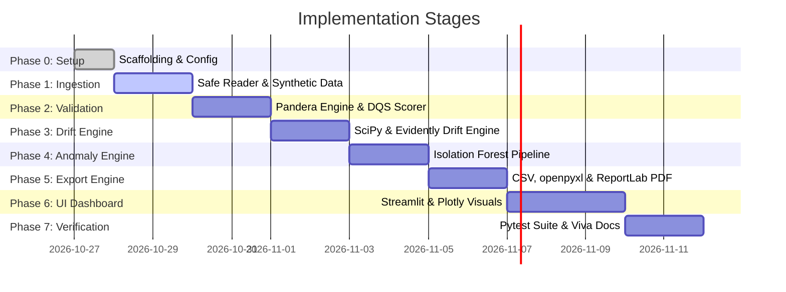

# Development Plan: Data Quality Monitoring & Anomaly Detection System

**Document Version:** 1.0.0  
**Project:** Data Quality Monitoring and Anomaly Detection System  
**Academic Target:** B.Tech AI & Data Science Capstone / Mini-Project  
**Status:** Approved for Execution  

---

## 1. Project Directory Structure & Modular Layout

The codebase is organized following modern Python software engineering principles (clean architecture, separation of concerns, high testability, and student-friendly readability):

```
data_quality_system/
│
├── PROJECT_SPEC.md                 # Complete system specifications & formal models
├── DEVELOPMENT_PLAN.md             # Phased implementation roadmap & tasks
├── README.md                       # Quickstart, setup guide, and project overview
├── requirements.txt                # Pinned production and development dependencies
│
├── data/                           # Sample & benchmark datasets (git-ignored/cached)
│   ├── reference_sample.csv        # Baseline clean reference dataset
│   ├── current_sample.csv          # Production batch with injected defects/drift
│   └── multi_sheet_demo.xlsx       # Multi-sheet workbook for testing sheet selector
│
├── src/                            # Core application source code
│   ├── __init__.py
│   ├── config.py                   # Central configuration, default thresholds & weights
│   │
│   ├── ingestion/                  # Data Ingestion & Immutability Layer
│   │   ├── __init__.py
│   │   ├── reader.py               # Robust CSV and XLSX reader with sheet selection
│   │   └── synthetic_generator.py  # Deterministic demo data generator (reproducible seed)
│   │
│   ├── validation/                 # Schema & Rule Validation Engine
│   │   ├── __init__.py
│   │   ├── pandera_schemas.py      # Declarative Pandera validation schemas & rules
│   │   └── quality_checker.py      # Missingness, uniqueness, and constraint verifier
│   │
│   ├── scoring/                    # Data Quality Scoring Engine
│   │   ├── __init__.py
│   │   ├── dqs_calculator.py       # Mathematical formulation of Composite DQS
│   │   └── metrics_aggregator.py   # Dimension aggregation & diagnostic summaries
│   │
│   ├── drift/                      # Statistical Drift Monitoring Engine
│   │   ├── __init__.py
│   │   ├── statistical_drift.py    # SciPy KS-test, Wasserstein, Chi-Square, JS-Div
│   │   └── evidently_suite.py      # Evidently Data Drift preset runner
│   │
│   ├── anomaly/                    # Machine Learning Anomaly Detection Engine
│   │   ├── __init__.py
│   │   ├── preprocessor.py         # Imputation, scaling, and categorical encoding
│   │   └── isolation_forest.py     # Isolation Forest model, path length scoring & ranking
│   │
│   ├── export/                     # Multi-Format Audit & Export Engine
│   │   ├── __init__.py
│   │   ├── csv_exporter.py         # Tabular diagnostic CSV generator
│   │   ├── excel_exporter.py       # Styled multi-sheet openpyxl Excel builder
│   │   └── pdf_exporter.py         # Academic/executive ReportLab PDF report builder
│   │
│   └── ui/                         # Streamlit Dashboard Presentation Layer
│       ├── __init__.py
│       ├── app.py                  # Main Streamlit entrypoint & navigation
│       ├── components.py           # Reusable UI widgets, KPI cards, banners
│       └── charts.py               # Interactive Plotly charts (drift, distributions, anomalies)
│
├── tests/                          # Automated Pytest Test Suite
│   ├── __init__.py
│   ├── conftest.py                 # Pytest fixtures (sample clean/dirty dataframes)
│   ├── test_ingestion.py           # Tests for CSV, multi-sheet XLSX, empty/bad files
│   ├── test_validation.py          # Tests for Pandera schemas, nulls, duplicates
│   ├── test_scoring.py             # Tests for DQS mathematical boundaries [0, 100]
│   ├── test_drift.py               # Tests for KS-test, Chi-square, and drift flags
│   ├── test_anomaly.py             # Tests for Isolation Forest fit, scoring, output
│   └── test_export.py              # Tests for CSV, openpyxl XLSX, and ReportLab PDF output
│
└── docs/                           # Academic & Viva Voce Documentation
    ├── RESEARCH_REPORT.md          # Full academic research paper draft
    ├── VIVA_VOCE_PREP.md           # Examiner questions, statistical rationale, answers
    └── ARCHITECTURE_EXPLAINED.md   # Architectural decisions and design trade-offs
```

---

## 2. Phased Implementation Roadmap



---

### Phase 0: Project Scaffolding & Configuration
**Goals:** Initialize repository layout, configure environment, establish dependency manifests, and define global configuration settings.

- **Tasks:**
  1. Create directory tree structure (`src/`, `tests/`, `docs/`, `data/`).
  2. Create `requirements.txt` with verified versions.
  3. Create `src/config.py`:
     - Default DQS dimension weights: $w_{\text{comp}}=0.25, w_{\text{uniq}}=0.15, w_{\text{val}}=0.30, w_{\text{cons}}=0.15, w_{\text{schema}}=0.15$.
     - Drift significance thresholds: $\alpha = 0.05$.
     - Isolation Forest hyperparameters: `n_estimators=100`, `contamination='auto'` or $0.05$, `random_state=42`.
  4. Ensure all modules have standard `__init__.py` files for clean imports.
- **Verification:** Import paths resolve cleanly; configuration loads defaults reliably.

---

### Phase 1: Data Ingestion & Synthetic Demo Data Engine
**Goals:** Safe, immutable reading of `.csv` and multi-sheet `.xlsx` files; deterministic generation of realistic synthetic benchmark datasets.

- **Tasks:**
  1. Implement `src/ingestion/reader.py`:
     - Function `get_excel_sheet_names(file_source) -> List[str]`.
     - Function `read_dataset(file_source, sheet_name=None, file_type=None) -> pd.DataFrame`.
     - Robust error handling: empty files, unsupported extensions, encoding issues (UTF-8, Latin-1 fallback), malformed delimiters.
     - Immutability guarantee: returns a fresh copy with defensive `.copy(deep=True)`.
  2. Implement `src/ingestion/synthetic_generator.py`:
     - Deterministic generation using `numpy.random.default_rng(seed=42)`.
     - Generates clean baseline dataset (`reference_df`) simulating customer transactions/financial metrics (e.g., `Customer_ID`, `Age`, `Income`, `Credit_Score`, `Transaction_Amount`, `Category`, `Timestamp`).
     - Generates degraded/drifted current dataset (`current_df`) with controlled injected defects:
       - 5% missing values in `Income`.
       - Duplicate rows injected.
       - Covariate drift injected into `Transaction_Amount` ($\mu_{ref}=150 \to \mu_{curr}=450$) and `Age`.
       - Categorical distribution shift in `Category`.
       - 10 extreme multivariate anomalies (e.g., Age 19 with Income \$800,000 and unusual transaction patterns).
- **Verification:** Unit tests verifying deterministic seed output, sheet extraction, and error handling on empty files.

---

### Phase 2: Schema Validation & Data Quality Scoring Engine
**Goals:** Declarative validation using Pandera; calculation of the composite Data Quality Score ($DQS$).

- **Tasks:**
  1. Implement `src/validation/pandera_schemas.py`:
     - Define `DataFrameSchema` with domain rules:
       - `Age`: $18 \le \text{Age} \le 100$
       - `Income`: $\ge 0$
       - `Credit_Score`: $300 \le \text{Score} \le 850$
       - `Category`: Categorical membership check.
     - Support custom rule loading or dynamic schema inference from reference data.
  2. Implement `src/validation/quality_checker.py`:
     - Calculate null count and percentage per column.
     - Detect duplicate rows based on subset keys or full row hash.
     - Identify type mismatches against expected data types.
     - Capture Pandera validation failure cases into structured tabular diagnostics.
  3. Implement `src/scoring/dqs_calculator.py`:
     - Compute individual dimension scores: $Q_{\text{comp}}, Q_{\text{uniq}}, Q_{\text{val}}, Q_{\text{cons}}, Q_{\text{schema}} \in [0, 100]$.
     - Compute weighted composite score $DQS$.
     - Generate structured report dictionary with ratings (e.g., Excellent: $\ge 90$, Good: $75-89$, Fair: $60-74$, Poor: $<60$).
     - Append documented score limitations and disclaimers to the output.
- **Verification:** Unit tests with known defect counts asserting exact expected numerical score outputs.

---

### Phase 3: Statistical & Distributional Drift Monitoring Engine
**Goals:** Rigorous detection of covariate shift and schema changes between reference and current datasets using Evidently and SciPy.

- **Tasks:**
  1. Implement `src/drift/statistical_drift.py`:
     - Continuous feature drift: Two-sample Kolmogorov-Smirnov test (`scipy.stats.ks_2samp`) and Wasserstein distance (`scipy.stats.wasserstein_distance`).
     - Categorical feature drift: Pearson's Chi-Square contingency test (`scipy.stats.chi2_contingency`) and Jensen-Shannon divergence (`scipy.spatial.distance.jensenshannon`).
     - Output structured metrics: statistic value, p-value, drift detected boolean (`p_value < alpha`), and severity rating.
  2. Implement `src/drift/evidently_suite.py`:
     - Integration with Evidently `Report` and `DataDriftPreset` to generate comprehensive drift evaluations.
     - Extraction of column-level drift results into clean Pandas DataFrames for UI visualization.
     - Graceful fallback: If Evidently encounters package version discrepancies, SciPy statistical engine provides 100% complete drift coverage.
  3. Include explicit documentation distinguishing drift from data errors.
- **Verification:** Test on synthetic drifted dataset; verify that drifted columns are flagged and stationary columns remain unflagged.

---

### Phase 4: Machine Learning Anomaly Detection Engine
**Goals:** Isolate multivariate anomalies using Scikit-learn's Isolation Forest with pre-processing, scoring, and clear interpretability.

- **Tasks:**
  1. Implement `src/anomaly/preprocessor.py`:
     - Scikit-learn pipeline for tabular data handling:
       - Numerical pipeline: SimpleImputer (median) + RobustScaler (resistant to outliers).
       - Categorical pipeline: SimpleImputer (most_frequent) + OneHotEncoder(handle_unknown='ignore').
     - Returns clean numerical feature matrix ready for tree partitioning.
  2. Implement `src/anomaly/isolation_forest.py`:
     - Configurable Isolation Forest estimator (`n_estimators`, `contamination`, `random_state`).
     - Predict outlier labels ($-1$ for outlier, $1$ for inlier).
     - Calculate continuous decision function scores $s(x, n)$ and normalize to $[0, 1]$ anomaly probability.
     - Extract top-$k$ most suspicious records.
     - Compute feature contribution heuristic (deviation of anomaly feature value from baseline median normalized by IQR).
     - Explicit documentation: label as "Suspicious Record for Human Review", not "Defective Data".
- **Verification:** Inject known multivariate outliers into synthetic test set and verify high anomaly ranking.

---

### Phase 5: Multi-Format Audit & Export Engine
**Goals:** Generate downloadable, formatted diagnostic artifacts across CSV, openpyxl Excel, and ReportLab PDF.

- **Tasks:**
  1. Implement `src/export/csv_exporter.py`:
     - Export detailed validation failure records, drift summary tables, and anomaly records to standard CSV byte buffers.
  2. Implement `src/export/excel_exporter.py`:
     - Multi-tab workbook creation via `openpyxl`:
       - Tab 1: `Executive_Summary` (KPI cards, overall DQS, breakdown).
       - Tab 2: `Data_Quality_Checks` (missing values, duplicate rows, Pandera failures).
       - Tab 3: `Distribution_Drift` (statistical test statistics, p-values, drift flags).
       - Tab 4: `ML_Anomalies` (flagged suspicious records with anomaly scores).
     - Professional styling: colored header bands (Navy Blue `#1B365D`), zebra striping, conditional red/green fills for pass/fail/drift alerts, column width auto-fitting.
  3. Implement `src/export/pdf_exporter.py`:
     - Academic-quality PDF report via `ReportLab` Platypus framework:
       - Document Title, metadata (student name, execution timestamp, dataset names).
       - Executive Summary with DQS gauge and dimension breakdown table.
       - High-priority findings and warning callouts.
       - Pandera validation findings table.
       - Drift analysis summary table with p-values.
       - Top suspicious anomaly records table.
       - Formal "Methodology & Limitations" section for academic rigor.
- **Verification:** Unit tests verifying valid file headers, non-empty byte streams, and valid PDF/XLSX structures.

---

### Phase 6: Streamlit Interactive Web Application & Plotly Visualizations
**Goals:** User-friendly, responsive dashboard displaying metrics, interactive plots, and export controls.

- **Tasks:**
  1. Implement `src/ui/charts.py`:
     - Plotly interactive histograms with dual KDE overlays for reference vs current distribution comparisons.
     - Plotly multi-dimensional scatter plot highlighting normal vs suspicious anomaly records.
     - Plotly radar chart displaying the 5 DQS quality dimensions ($Q_{comp}, Q_{uniq}, \dots$).
  2. Implement `src/ui/components.py`:
     - Metric cards with color-coded badges (Green: Pass, Yellow: Warning, Red: Critical).
     - Educational expanders explaining *Why is this metric important?* for viva preparation.
  3. Implement `src/ui/app.py`:
     - Sidebar navigation:
       - Dataset Ingestion (File Uploader for CSV/XLSX, Worksheet Selector, or "Load Demo Benchmark").
       - Analytical Configuration (Weights slider, Drift p-value threshold, Anomaly contamination slider).
     - Tabbed Main View:
       - Tab 1: **Dataset Overview & Schema** (Shape, types, preview, immutability confirmation).
       - Tab 2: **Data Quality & DQS Scorecard** (Dimension breakdown, missingness heatmap, duplicate rows).
       - Tab 3: **Distributional Drift Analysis** (Statistical tests, p-values, KS-test density plots).
       - Tab 4: **ML Anomaly Detection** (Suspicious records table, feature importance, scatter view).
       - Tab 5: **Export & Audit Reports** (One-click downloads for CSV, styled XLSX, and PDF report).
- **Verification:** End-to-end user flow: upload file $\to$ explore tabs $\to$ download reports.

---

### Phase 7: Automated Test Suite (Pytest) & Edge-Case QA
**Goals:** Comprehensive automated test coverage guaranteeing stability, correct math, and graceful degradation.

- **Tasks:**
  1. Set up `tests/conftest.py` with reusable fixtures:
     - Perfect clean baseline dataframe.
     - Flawed dataframe (known nulls, duplicates, invalid values).
     - Drifted dataframe.
     - Multivariate anomalous dataframe.
  2. Implement test files:
     - `test_ingestion.py`: CSV parsing, multi-sheet Excel extraction, empty file handling.
     - `test_validation.py`: Null profiler, duplicate detector, Pandera constraint check.
     - `test_scoring.py`: DQS math verification, boundary clamping $[0, 100]$, weight normalization.
     - `test_drift.py`: KS-test and Chi-Square p-values, drift threshold triggers.
     - `test_anomaly.py`: Isolation Forest output format, anomaly score range, top-k ranking.
     - `test_export.py`: Excel workbook structure and ReportLab PDF generation validity.
- **Verification:** Run `pytest tests/` with zero failures and $>80\%$ code coverage.

---

### Phase 8: Academic Research Paper & Viva Voce Defense Preparation
**Goals:** Prepare documentation for academic submission and oral examination (viva voce).

- **Tasks:**
  1. Write `docs/RESEARCH_REPORT.md`:
     - Abstract, Introduction, Problem Definition.
     - Theoretical Framework (Pandera Declarative Logic, KS-Test & Chi-Square Mathematics, Isolation Forest Algorithm).
     - Empirical Experimental Evaluation (Results on Synthetic and Real-world benchmark data).
     - Limitations, Threats to Validity, and Future Work (Continuous Streaming, Auto-remediation).
     - References & Academic Citations.
  2. Write `docs/VIVA_VOCE_PREP.md`:
     - 20 anticipated examiner viva questions with rigorous technical answers.
     - Deep-dive explanations:
       - *Why Isolation Forest instead of DBSCAN or Autoencoders?*
       - *How to differentiate between Covariate Shift and Pipeline Defects?*
       - *Why not rely solely on simple mean/standard deviation checks for drift?*
       - *What are the mathematical limitations of a single composite DQS?*
- **Verification:** Complete peer-review check of all formulas, citations, and terminology.

---

## 3. Risk Assessment & Engineering Mitigations

| Risk / Challenge | Potential Impact | Engineering Mitigation Strategy |
| :--- | :--- | :--- |
| **Python 3.14 Compatibility** | Newer standard libraries or C-extensions in certain packages may encounter runtime warnings. | Verify package functionality; use standard NumPy/SciPy/Scikit-learn APIs; maintain robust fallback to SciPy drift if external libraries encounter version warnings. |
| **Large Dataset Memory Exhaustion** | Ingesting large Excel workbooks could trigger high RAM usage. | Use `openpyxl` read-only mode (`read_only=True`) for sheet metadata; enforce max file size limit warning in UI; operate on downsampled slices for ML anomaly visualization if $N > 50,000$. |
| **Statistical Test False Positives** | With massive sample sizes ($N > 100,000$), standard K-S test $p$-values approach zero even for trivial distribution shifts. | Implement Wasserstein distance (Earth Mover's Distance) alongside K-S test to measure practical magnitude of shift, not just statistical rejection of null hypothesis. |
| **Data Mutability / Corruption** | Intermediate operations could inadvertently mutate input data. | Enforce immutability through defensive copying (`.copy(deep=True)`) at the ingestion boundary; functional programming design in scoring engines. |
