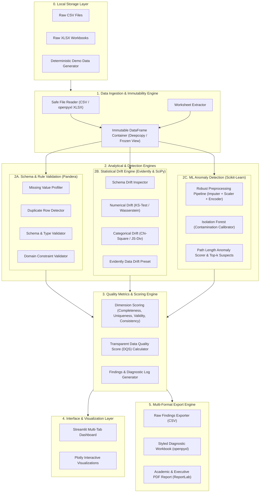

# Project Specification: Data Quality Monitoring & Anomaly Detection System

**Document Version:** 1.0.0  
**Status:** Approved for Implementation  
**Target Audience:** Academic Evaluators, Project Mentors, Viva Examiners, and Software Engineering Reviewers  
**Academic Context:** B.Tech Artificial Intelligence & Data Science (Year 3 Mini-Project & Capstone Prototype)  
**Author / Candidate:** Student Project Team  

---

## 1. Executive Summary & Problem Formulation

### 1.1 Problem Statement
Modern machine learning (ML) models and analytical pipelines fail predominantly not due to algorithmic defects, but due to **silent data degradation**. These failures manifest in three distinct dimensions:
1. **Syntactic and Schema Defects:** Missing records, schema drift, invalid types, duplicate primary keys, and rule violations.
2. **Distributional Drift (Covariate Shift):** Statistical divergence between training/reference distributions ($P_{ref}(X)$) and production/inference distributions ($P_{curr}(X)$) without ground-truth label availability.
3. **Multivariate Outliers & Anomalies:** Subtly corrupted or rare multivariate observations that satisfy univariate boundary conditions but violate multivariate joint distributions.

Existing industry tools (e.g., Great Expectations, Monte Carlo, Datadog) are either heavy cloud-native enterprise services requiring SaaS telemetry or fractured point solutions. Furthermore, academic projects often conflate:
- **Anomalies vs. Data Errors:** An anomaly detected via unsupervised ML is a *statistically unusual record*, not definitive proof of data corruption.
- **Data Drift vs. Pipeline Failures:** Distributional drift reflects natural environmental evolution (covariate shift), not necessarily a data pipeline failure.
- **Arbitrary Scores vs. Rigorous Formulations:** Ad-hoc scoring without transparent mathematical definitions obscures data health.

### 1.2 System Mission
The **Data Quality Monitoring and Anomaly Detection System** is an offline-first, privacy-preserving, transparent Python framework and interactive dashboard designed to:
- Ingest tabular files (`.csv`, `.xlsx` with arbitrary sheet selection) safely without mutating source data.
- Enforce declarative structural validation rules via **Pandera**.
- Track univariate and multivariate statistical drift using **Evidently** and **SciPy**.
- Isolate multivariate anomalous records using **Scikit-learn Isolation Forest**.
- Compute a deterministic, mathematically grounded **Data Quality Score (DQS)** with explicit limitations documented.
- Provide a clean **Streamlit** user interface with **Plotly** visualizations.
- Generate reproducible audit artifacts across **CSV**, styled **openpyxl XLSX**, and publication-ready **ReportLab PDF**.
- Serve as an open, modular, academic-grade reference codebase with full **Pytest** verification.

---

## 2. Core Architectural Design

### 2.1 System Architecture Diagram
The system follows a strict **Layered Modular Architecture** with clear boundaries between Ingestion, Validation, Drift Detection, ML Anomaly Isolation, Metrics Aggregation, Reporting, and User Interface.

### 2.2 Data Flow & Execution Pipeline
1. **User Input / Ingestion:** User uploads a file or selects synthetic demo data. If `.xlsx`, sheet enumeration allows the user to select the target worksheet. Source bytes are stored in-memory; original data is never modified.
2. **Defensive Validation (Syntactic):** Pandera schema parses column types, checks null counts, enforces boundary ranges (e.g., $Age \in [0, 120]$, $Income \ge 0$), and flags duplicate rows.
3. **Reference Comparison (Distributional):** If a reference baseline is supplied (or generated), the Drift Engine computes statistical distances for numerical features (Two-sample Kolmogorov-Smirnov test or Wasserstein metric) and categorical features (Pearson's Chi-Square test or Jensen-Shannon divergence).
4. **Unsupervised Outlier Detection (Multivariate):** Features are encoded and scaled through an isolated pipeline. The `IsolationForest` fits on reference or baseline features and predicts anomaly status ($\pm 1$) and decision function scores ($s(x, n)$) on current data.
5. **Score Aggregation:** Dimension scores ($Q_{comp}, Q_{uniq}, Q_{val}, Q_{cons}, Q_{schema}$) are computed and weighted into an overall composite $DQS \in [0, 100]$.
6. **Presentation & Reporting:** The dashboard renders summary KPI cards, diagnostic tables, drift plots, and anomaly scatter matrices. The export engine compiles findings into CSV, formatted Excel with conditional highlighting, and a PDF report.

---

## 3. Technology Stack & Scientific Rationale

| Layer / Capability | Selected Technology | Alternative Evaluated | Scientific & Engineering Rationale for Selection |
| :--- | :--- | :--- | :--- |
| **Language Runtime** | **Python (>= 3.10, compatible with 3.14)** | Julia, R, Rust | Universal standard in AI/Data Science curricula; extensive ecosystem support for ML and tabular processing. |
| **Data Manipulation** | **Pandas & NumPy** | Polars, DuckDB | Ubiquitous tabular data abstraction, essential for student viva defense; mature interoperability with Scikit-learn and Pandera. |
| **Schema Validation** | **Pandera** | Pydantic, Great Expectations | Pandera is specifically designed for DataFrame-level validation with vectorized checking, declarative statistical checks, and low execution overhead compared to Great Expectations. |
| **Drift Monitoring** | **Evidently AI & SciPy** | Alibi Detect, Custom Scripts | Evidently provides battle-tested production metrics and tests for covariate shift. SciPy provides foundational statistical test implementations (KS-test, Chi-square) for viva transparency. |
| **Anomaly Detection** | **Scikit-learn Isolation Forest** | Local Outlier Factor (LOF), One-Class SVM, Autoencoders | Isolation Forest scales as $\mathcal{O}(n \log n)$ via random tree isolation, does not require distance metric computation (avoiding distance metric collapse in high dimensions), and requires no labeled training data. |
| **Web Interface** | **Streamlit** | Gradio, Flask, FastAPI + React | Rapid reactive dashboarding with built-in state management, interactive widgets, zero JavaScript required, ideal for B.Tech project demonstrations. |
| **Visualizations** | **Plotly Graph Objects / Express** | Matplotlib, Seaborn | Plotly generates responsive, interactive JavaScript/WebGL charts directly inside Streamlit with hover inspections, zoom, and drill-down. |
| **Excel Manipulation** | **openpyxl** | xlsxwriter, pyexcel | Standard open-source library for reading multi-sheet `.xlsx` files and creating formatted, colored, multi-tab audit workbooks. |
| **PDF Generation** | **ReportLab** | WeasyPrint, pdfkit, FPDF | Standalone, pure-Python PDF rendering engine with exact coordinate and Platypus flowable layout control; does not depend on system-level headless browsers (wkhtmltopdf/WebKit). |
| **Testing Framework** | **Pytest** | Unittest, Robot Framework | Expressive assertion syntax, parameterized fixtures, clear failure diffs, and standard in Python engineering. |

---

## 4. Mathematical Formulations & Analytical Methodology

### 4.1 Data Quality Score (DQS) Formulation
To prevent arbitrary metric assignment, the Data Quality Score ($DQS$) is mathematically defined as a normalized multi-criteria utility function:

$$DQS = \sum_{k \in \mathcal{K}} w_k \cdot Q_k \quad \text{where} \quad \sum_{k \in \mathcal{K}} w_k = 1.0, \quad Q_k \in [0, 100]$$

Where $\mathcal{K} = \{\text{Completeness}, \text{Uniqueness}, \text{Validity}, \text{Consistency}, \text{Schema}\}$ with default academic weights:
- $w_{\text{comp}} = 0.25$ (Completeness)
- $w_{\text{uniq}} = 0.15$ (Uniqueness)
- $w_{\text{val}} = 0.30$ (Domain Validity & Constraints)
- $w_{\text{cons}} = 0.15$ (Type & Format Consistency)
- $w_{\text{schema}} = 0.15$ (Schema & Column Adherence)

#### Dimension Metrics:
1. **Completeness ($Q_{\text{comp}}$):** Ratio of non-null cells across $N$ rows and $M$ columns:
   $$Q_{\text{comp}} = \left( 1 - \frac{\sum_{i=1}^{N} \sum_{j=1}^{M} \mathbb{I}(\text{cell}_{i,j} \text{ is null})}{N \cdot M} \right) \times 100$$
2. **Uniqueness ($Q_{\text{uniq}}$):** Proportion of non-duplicate records based on primary identifier or full row hashing:
   $$Q_{\text{uniq}} = \left( 1 - \frac{N_{\text{duplicate rows}}}{N} \right) \times 100$$
3. **Validity ($Q_{\text{val}}$):** Proportion of values satisfying declared domain rules (ranges, regex patterns, allowed categorical sets):
   $$Q_{\text{val}} = \left( \frac{\sum_{j=1}^{M_{rules}} N_{valid, j}}{\sum_{j=1}^{M_{rules}} N_{total, j}} \right) \times 100$$
4. **Consistency ($Q_{\text{cons}}$):** Proportion of records conforming strictly to expected data types without silent truncation or parsing failures:
   $$Q_{\text{cons}} = \left( 1 - \frac{N_{\text{type mismatch}}}{N \cdot M} \right) \times 100$$
5. **Schema Adherence ($Q_{\text{schema}}$):** Penalty based on missing expected columns and unexpected column injections:
   $$Q_{\text{schema}} = \max\left(0, 100 - 25 \cdot M_{\text{missing}} - 10 \cdot M_{\text{unexpected}}\right)$$

#### Explicit Limitations of DQS (Academic Disclosure):
- **Independence Assumption:** DQS computes aggregate weighted averages, assuming dimensional independence. In real data, a single missing primary key may invalidate an entire row's analytical validity.
- **Sensitivity to Domain Context:** Default weights are heuristic; a 1% missing value rate in a medical diagnosis column is critical, whereas 1% in an optional comments column is negligible.
- **Non-Semantics:** DQS measures syntactic and distributional compliance, not ground-truth factual correctness (e.g., an age of 35 is syntactically valid even if the real person is 62).

---

### 4.2 Statistical Drift Detection Formulation
Drift detection tests the null hypothesis ($H_0$) that reference sample $S_{ref}$ and current sample $S_{curr}$ originate from the same continuous or discrete distribution.

#### A. Continuous Features: Two-Sample Kolmogorov-Smirnov (K-S) Test
Measures the supreme distance between empirical cumulative distribution functions $F_{ref}(x)$ and $F_{curr}(x)$:

$$D_{KS} = \sup_x |F_{ref}(x) - F_{curr}(x)|$$

$H_0$ is rejected if the computed $p$-value $<\alpha$ (standard threshold $\alpha = 0.05$).  
For small sample sizes or sensitive distributions, **Wasserstein Distance (Earth Mover's Distance)** is computed:

$$W_1(u, v) = \int_{-\infty}^{\infty} |U(x) - V(x)| dx$$

#### B. Categorical Features: Pearson's Chi-Square ($\chi^2$) Goodness-of-Fit Test
Tests categorical frequency shifts across $k$ bins/categories:

$$\chi^2 = \sum_{i=1}^{k} \frac{(O_i - E_i)^2}{E_i}$$

Where $O_i$ is current observed counts and $E_i$ is expected counts derived from the reference distribution proportions.

#### Vital Engineering Nuance: Drift vs. Error
*Data drift is a statistical covariate shift caused by external real-world dynamics (e.g., inflation driving transaction values higher, seasonal temperature shifts), not necessarily an upstream pipeline defect. The system reports drift as an operational warning for model retraining, not as a data corruption error.*

---

### 4.3 Unsupervised Anomaly Detection Formulation (Isolation Forest)
Isolation Forest isolates anomalies instead of profiling normal points. Since anomalies are few and structurally distinct, they are isolated closer to the root of a random decision tree.

#### Mathematical Foundation:
Given a dataset of $n$ instances, the anomaly score $s(x, n)$ for an observation $x$ is defined as:

$$s(x, n) = 2^{-\frac{\mathbb{E}(h(x))}{c(n)}}$$

Where:
- $h(x)$ is the path length of observation $x$ (number of edges traversed from root to termination node in an isolation tree).
- $\mathbb{E}(h(x))$ is the expected path length across an ensemble of $t$ isolation trees (default: $t=100$).
- $c(n)$ is the average path length of unsuccessful searches in a Binary Search Tree (BST) over $n$ points:
  $$c(n) = 2 \left( \ln(n - 1) + \gamma \right) - \frac{2(n - 1)}{n}$$
  where $\gamma \approx 0.5772156649$ (Euler-Mascheroni constant).

#### Score Interpretation:
- If $\mathbb{E}(h(x)) \to 0 \implies s \to 1$: Observation is isolated with very few splits $\rightarrow$ **High Anomaly Probability**.
- If $\mathbb{E}(h(x)) \to c(n) \implies s \to 0.5$: Observation behaves like an average sample.
- If $\mathbb{E}(h(x)) \to n - 1 \implies s \to 0$: Observation requires maximum splits $\rightarrow$ **Definitely Normal**.

#### Vital Engineering Nuance: ML Anomaly vs. Error
*An ML anomaly is an uncharacteristically isolated data point in multivariate feature space. It may represent an extraordinary valid event (e.g., a Black Friday bulk purchase or a rare medical condition) rather than erroneous data. The system categorizes it as a **Suspicious Record for Human Review**, never automatically deleting or altering it.*

---

## 5. Detailed Functional Requirements (FR)

| Req ID | Title | Description | Acceptance Criteria |
| :--- | :--- | :--- | :--- |
| **FR-1** | Multi-Format Ingestion | System must parse `.csv` (comma, semicolon, tab delimited) and `.xlsx` files safely. | User uploads file; system auto-detects delimiter for CSV; reads sheets for XLSX; returns pandas DataFrame without writing to disk or modifying source. |
| **FR-2** | Excel Worksheet Selection | System must detect all worksheet names in multi-sheet Excel workbooks and allow user selection. | If file is `.xlsx`, dropdown exposes all available sheets; selecting a sheet loads that specific sheet immediately. |
| **FR-3** | Immutability Assurance | System must guarantee read-only handling of uploaded raw data. | Ingestion engine operates on copies/memory buffers; raw files are never overwritten; operations return derived copies. |
| **FR-4** | Syntactic Data Validation | Perform complete checks on missing values, duplicates, datatypes, and Pandera rules. | Quantifies null counts per column, duplicate row count, invalid values, and schema deviations. |
| **FR-5** | Transparent DQS Calculation | Calculate composite Data Quality Score with documented constituent dimensions. | Returns $DQS \in [0, 100]$ alongside broken-down dimension scores and plain-language audit logs. |
| **FR-6** | Statistical Drift Monitoring | Compare reference dataset with current dataset for schema and distribution shifts. | Computes KS-test/Wasserstein for numerical columns, Chi-square/JS for categorical columns; flags columns exceeding threshold. |
| **FR-7** | Unsupervised Anomaly Detection | Run Scikit-learn Isolation Forest on selected numerical/categorical features. | Outputs anomaly label ($\pm 1$), anomaly score $s \in [0, 1]$, and highlights the top-$k$ most suspicious records with feature contributions. |
| **FR-8** | Interactive Dashboard (UI) | Present metrics, distributions, drift alerts, and anomaly records in Streamlit. | Responsive tabs, KPI cards, Plotly interactive histograms/scatter plots, data filtering controls. |
| **FR-9** | Multi-Format Audit Exports | Export analysis summary and findings to CSV, openpyxl XLSX, and ReportLab PDF. | Generates downloadable CSV tables, color-coded multi-sheet Excel with styled headers, and formatted academic-style PDF report. |
| **FR-10**| Synthetic Demo Data Generator | Include deterministic, reproducible generator for demo and testing scenarios. | Provides clean baseline reference data and flawed/drifted current data (controlled injected anomalies, missingness, drift) via fixed random seed. |
| **FR-11**| Automated Testing & QA | Complete automated test suite using Pytest covering all engines and edge cases. | Tests pass across ingestion, validation, drift, anomaly detection, scoring, and export utilities with $>80\%$ code coverage. |
| **FR-12**| Academic & Research Report | Comprehensive documentation and academic research paper draft suitable for B.Tech project submission. | Provides research paper draft (`RESEARCH_REPORT.md`), project viva voce defense preparation guide, and API documentation. |

---

## 6. Non-Functional Requirements (NFR)

1. **NFR-1: Data Privacy & Offline Execution:**
   - 100% of data processing, machine learning inference, and report compilation must execute locally within the execution sandbox/host machine.
   - Zero outbound HTTP network calls for user dataset processing. No third-party LLM or external cloud analytics APIs.
2. **NFR-2: Performance & Latency:**
   - Datasets up to 100,000 rows and 50 columns must be validated and processed within 10 seconds on standard consumer laptop hardware (8GB RAM, modern multi-core CPU).
   - Ingestion and scoring must not exceed 2GB memory footprint during peak execution.
3. **NFR-3: Defensive Robustness & Error Handling:**
   - Graceful handling of zero-byte files, non-tabular files, single-column files, datasets with 100% null columns, and mismatched schemas between reference and current sets.
   - Clear, user-friendly error banners in Streamlit rather than raw Python tracebacks.
4. **NFR-4: Code Modularity & Pedagogical Clarity:**
   - Strict separation of concerns (Model-View-Controller / Service-Oriented pattern).
   - Clean docstrings (Google/NumPy format) explaining function parameters, return types, mathematical logic, and exceptions for B.Tech viva presentation.

---

## 7. Assumptions, Boundaries & Constraints

1. **Tabular Focus:** System targets structured tabular data (CSV, Excel). Unstructured text documents, audio, video, and streaming event buses (Kafka) are out of scope for this version.
2. **Tabular Size Limit:** Recommended for in-memory processing up to 500,000 records. Datasets larger than 1GB should be chunked or sampled.
3. **Reference Dataset Requirement for Drift:** Statistical drift monitoring requires two inputs: a baseline reference dataset (historical clean benchmark) and a current dataset (production batch). If the user provides only one dataset, drift detection is automatically bypassed while schema validation, DQS, and anomaly detection proceed normally.
4. **Target Platform:** Cross-platform (Windows, Linux, macOS) on Python 3.10 through 3.14.

---

## 8. Detailed Acceptance Criteria Matrix (Given-When-Then)

| ID | Feature | Scenario | Given | When | Then |
| :--- | :--- | :--- | :--- | :--- | :--- |
| **AC-01** | Ingestion | Multi-sheet Excel upload | An Excel workbook with sheets `['Sales_2025', 'Sales_2026', 'Reference']` | User selects `Sales_2026` from sheet dropdown | Only `Sales_2026` is loaded into DataFrame; raw workbook file remains unmodified. |
| **AC-02** | Ingestion | Empty or corrupted file | A 0-byte file or an unparseable binary file | User attempts to load file | System displays descriptive error notification: *"Input file is empty or corrupted"* without crashing. |
| **AC-03** | Validation | Null & Duplicate detection | A dataset with 1,000 rows, 50 nulls in column A, and 20 identical rows | Pandera validation pipeline executes | System outputs exact metrics: 50 nulls (5%), 20 duplicate rows (2%), and adjusts $Q_{\text{comp}}$ and $Q_{\text{uniq}}$. |
| **AC-04** | Scoring | Transparent DQS breakdown | Evaluated dataset with known defect rates | Scoring engine calculates DQS | Returns composite score and dictionary containing each dimension ($Q_{comp}, Q_{uniq}, Q_{val}, Q_{cons}, Q_{schema}$) and weights used. |
| **AC-05** | Drift | Distributional Covariate Shift | Reference dataset ($Age \sim \mathcal{N}(25, 5)$) and Current dataset ($Age \sim \mathcal{N}(45, 10)$) | Drift engine evaluates continuous variables | KS-test returns $p < 0.01$, flags $Age$ as drifted, displays reference vs current distribution overlay plot. |
| **AC-06** | Anomaly | Isolation Forest Isolation | Current dataset with 5 injected multivariate outliers | Anomaly engine runs with contamination=0.01 | Identifies top outlier records, tags them with negative anomaly score, ranks them by suspicion index, and notes: *"Suspicious record, human verification recommended"*. |
| **AC-07** | Export | Formatted XLSX generation | Full analysis completed | User clicks "Export to Excel" | Downloads `.xlsx` workbook containing styled tabs: `Overview_KPIs`, `Validation_Errors`, `Drift_Report`, `Anomalies` with openpyxl styling. |
| **AC-08** | Export | Publication-Grade PDF | Full analysis completed | User clicks "Generate PDF Report" | Downloads ReportLab PDF containing cover page, executive metrics table, drift findings, and methodology disclosure. |
| **AC-09** | Synthetic | Demo data generation | Clean and drifted parameters selected | User clicks "Load Demo Datasets" | Generates deterministic reference DataFrame and current corrupted DataFrame using fixed random seed `42`. |
| **AC-10** | QA | Automated test suite | All modules implemented | Pytest is executed via command line | 100% of unit and integration tests pass with zero errors. |
